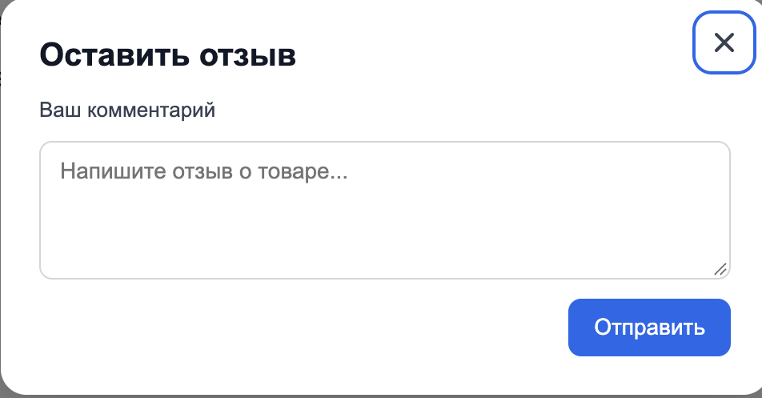

## Выполненные задачи

### 1. Архитектура и структура
Проект организован по слоям: `shared/`, `features/`, `pages/`, `widgets/`. UI-компоненты (`ClickCounter`, `IconButton`, `Modal`, `Rating`, `Spinner`) вынесены в `src/shared/ui` — только презентационные, без бизнес-логики, API и стора, данные и колбэки принимают через props. Фичи изолированы в отдельные папки (`features/cart`, `features/favourites`, `features/navigate-back`, `features/search` и т.д.)

### 2. Оптимизация рендеров
Через React DevTools Profiler найден hotspot — список товаров/корзины. Компоненты с неизменными props обёрнуты в `React.memo` (`CartItem`, `ProductCard`, элементы списков). В местах с вычислениями и колбэками применены `useMemo`/`useCallback` (фильтрация, обработчики в списках).

### 3. React.Portal для модалок
В `public/index.html` добавлен `

`. Компонент `Modal` в `src/shared/ui/Modal` реализован через `ReactDOM.createPortal`. Закрытие работает по крестику, клику вне области и клавише ESC. Фокус при открытии ставится на кнопку закрытия, при закрытии возвращается на элемент-триггер.

### 4. useRef — реальное применение
`ClickCounter` в `src/shared/ui/ClickCounter` использует `useRef` для счётчика кликов без перерендера.

### 5. Собственные сборки (esbuild)
Создан альтернативный конфиг `esbuild.config.js` (React + TS + SVG через `esbuild-svg`, CSS). Сборка работает: `npm run dev:esbuild`. В README приведено сравнение с Webpack:

| Метрика | Webpack 5 | esbuild |
|---------|-----------|---------|
| Время production-сборки | 17.1 с | 0.69 с |
| Размер JS-бандла | 1.02 MB | 1.1 MB |
| Размер папки сборки | 1.0 MB | ~1.2 MB |

Esbuild быстрее примерно в 25 раз при сопоставимом размере бандла.

### 6. React 19 Hooks
В `AddCommentForm` использован `useActionState` для отправки комментария с автоматическим reset формы после успешной отправки. (Или: в `LikeButton`/`CartItem` использован `useOptimistic` для мгновенной UI-реакции до ответа сервера — указать, что именно у тебя.)

Скрины:
Модальное окно, реализованное с помощью Portal

